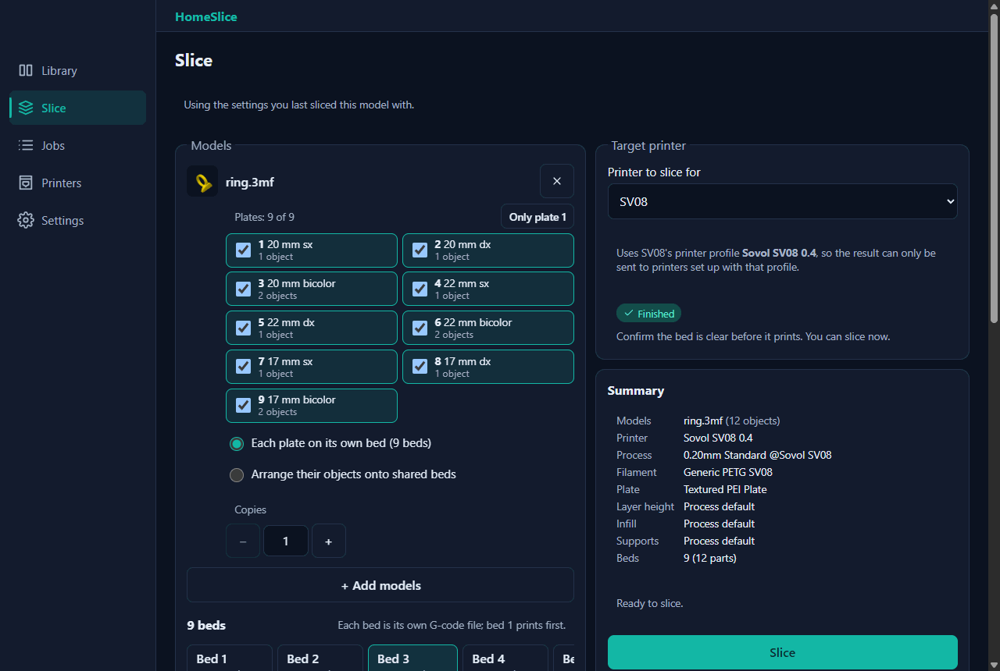
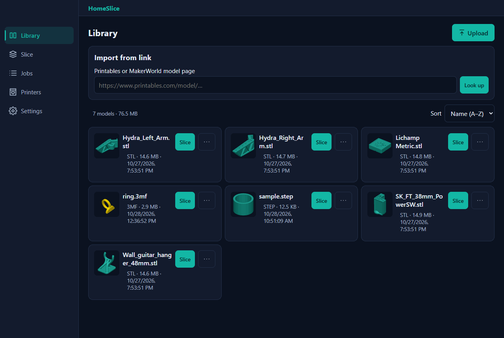
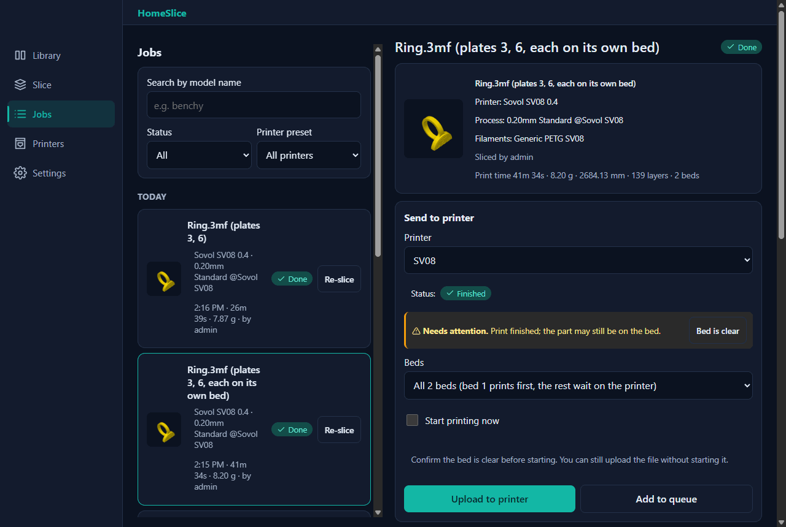
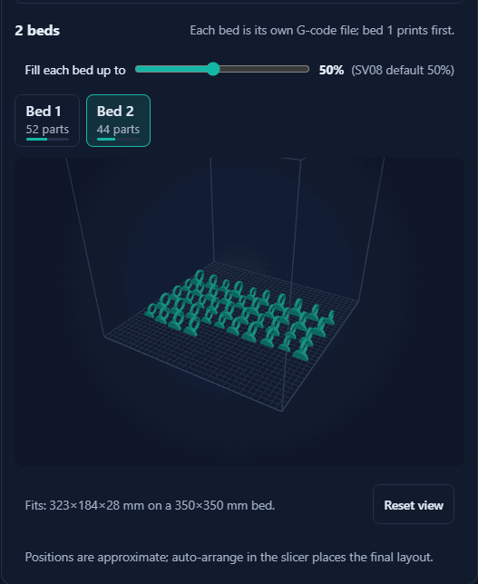
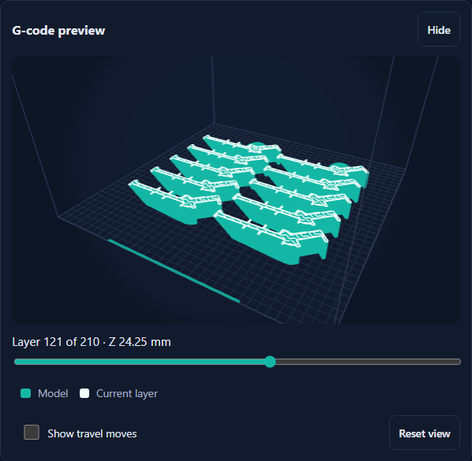
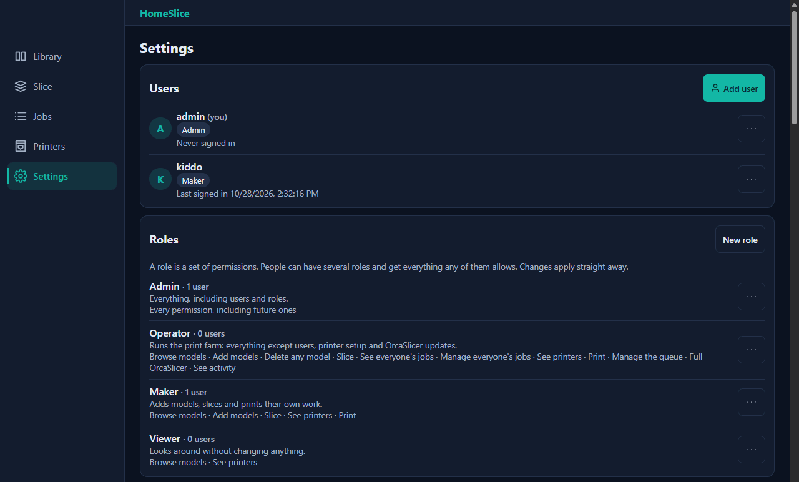
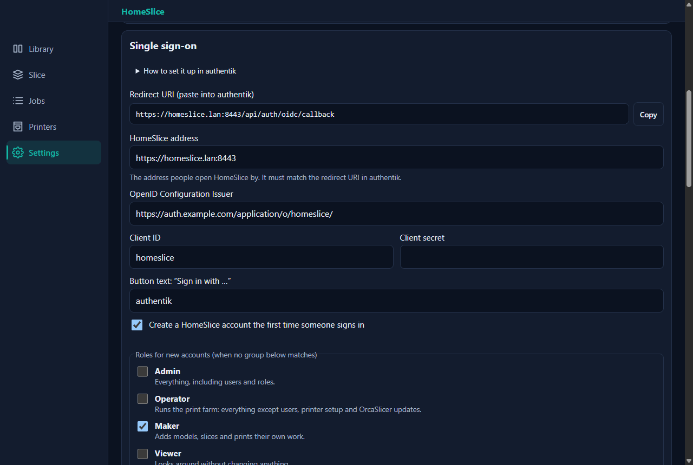
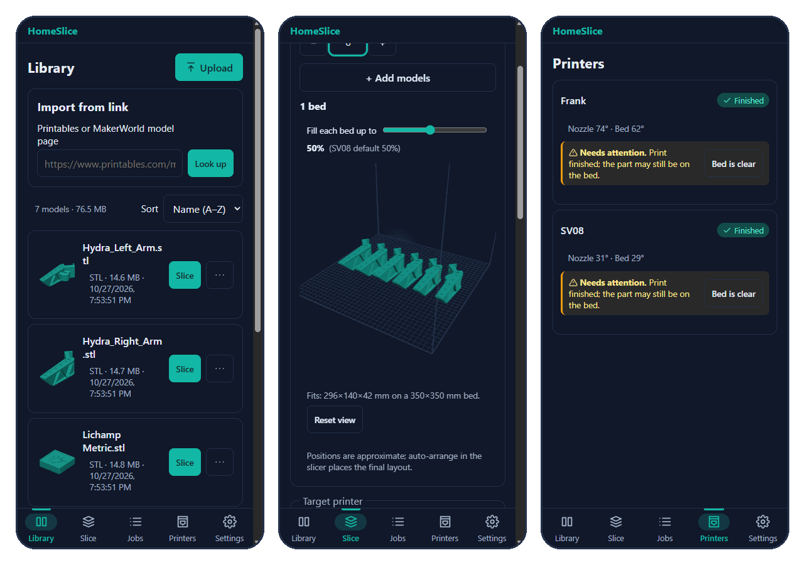
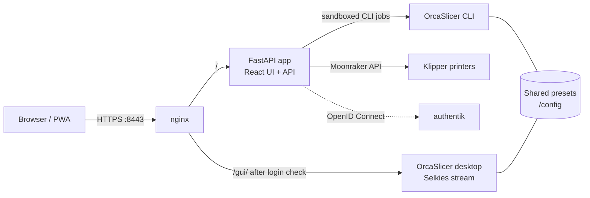

<div align="center">

# HomeSlice

**Your 3D-printing workshop in the browser.**<br>
A self-hosted, mobile-first front end for [OrcaSlicer](https://github.com/OrcaSlicer/OrcaSlicer): keep a model library, slice with your own presets, preview the G-code and send it straight to your Klipper printers, from any phone, tablet or desktop.

[](https://github.com/121Jigawatt/HomeSlice/actions/workflows/ci.yml)




</div>

---

## Contents

- [Features](#features)
- [Screenshots](#screenshots)
- [Quick start](#quick-start)
- [Configuration](#configuration)
- [Users, roles and single sign-on](#users-roles-and-single-sign-on)
- [How it works](#how-it-works)
- [Security](#security)
- [Development](#development)
- [Roadmap](#roadmap)

## Features

| | |
| --- | --- |
| 📚 **Model library** | Upload STL, 3MF, OBJ, STEP and AMF files (drag and drop works), or import from a Printables link. Thumbnails are rendered automatically. |
| 🔪 **Slicing with your presets** | Uses the printer, process and filament presets you already have in OrcaSlicer, with quick overrides for layer height, infill, supports and plate type. |
| 🧩 **Multi-plate projects** | Bambu Studio and OrcaSlicer 3MF projects keep their saved plates. Slice any set of plates, each on its own bed or packed together. |
| 🛏️ **Bed planning** | Copies and loose parts are spread over as many beds as needed, filled to a per-printer limit. A 3D preview shows every bed before you slice. |
| 👀 **G-code preview** | Scrub through layers in a 3D G-code viewer, with supports and travel moves. G-code files get embedded thumbnails for Mainsail, Fluidd and KlipperScreen. |
| 🖨️ **Printers and queue** | Live status, temperatures and webcams for Klipper (Mainsail/Fluidd) printers. Send now or queue prints that start automatically once you confirm the bed is clear. |
| 🎯 **Per-printer defaults** | Link each printer to its OrcaSlicer profile so G-code can never be sent to the wrong machine. One tap re-slices a job for another printer. |
| 👥 **Multi-user with roles** | Admin, Operator, Maker and Viewer roles, or your own from 14 permissions. Optional **Sign in with authentik** (OpenID Connect). |
| 🖥️ **Full OrcaSlicer, too** | The complete OrcaSlicer desktop runs in the browser for preset editing and advanced plate work, using the same profiles. |
| 🔄 **Safe updates** | Official OrcaSlicer releases are installed automatically from stable, pre-release or nightly channels, checked against GitHub's SHA-256, with one-click rollback. |
| 📱 **Installable app** | A responsive PWA with a bottom tab bar on phones and a sidebar on larger screens. |

## Screenshots

<table>
  <tr>
    <td width="50%"></td>
    <td width="50%"></td>
  </tr>
  <tr>
    <td align="center"><b>Library</b>: upload or import models; thumbnails are generated for you.</td>
    <td align="center"><b>Jobs</b>: results, stats and sending to a printer or its queue.</td>
  </tr>
  <tr>
    <td align="center"></td>
    <td align="center"></td>
  </tr>
  <tr>
    <td align="center"><b>Bed planning</b>: copies split across beds, previewed per bed.</td>
    <td align="center"><b>G-code preview</b>: scrub through every layer before printing.</td>
  </tr>
  <tr>
    <td width="50%"></td>
    <td width="50%"></td>
  </tr>
  <tr>
    <td align="center"><b>Users and roles</b>: built-in roles or your own.</td>
    <td align="center"><b>Single sign-on</b>: connect authentik in a few fields.</td>
  </tr>
</table>

<p align="center">
  <br>
  <b>On your phone</b>: the whole app works one-handed, from upload to print.
</p>

## Quick start

HomeSlice ships as one container image, `ghcr.io/121jigawatt/homeslice`, built by CI on every push to `main`.

### TrueNAS SCALE

1. Go to **Apps → Discover Apps → ⋮ → Install via YAML** and paste [deploy/truenas/docker-compose.yaml](deploy/truenas/docker-compose.yaml). Set `HOMESLICE_TLS_HOSTS` to the address you'll open HomeSlice by.
2. Open the app logs and copy the **setup token** line.
3. Browse to `https://<nas>:8443`, accept the certificate warning, and create your admin account with the token.
4. OrcaSlicer downloads and installs itself on first start; progress shows under **Settings**.
5. Open **Settings → OrcaSlicer engine → Open full OrcaSlicer** once to import or create your printer, filament and process presets. The Library page shows a checklist until setup is complete.

### Any Docker host

The same compose file works with plain Docker:

```bash
docker compose -f deploy/truenas/docker-compose.yaml up -d
docker logs homeslice 2>&1 | grep "setup token"
```

Storage uses two named volumes. To use your own folders instead, replace them with host paths:

| Volume | Holds |
| --- | --- |
| `/config` | OrcaSlicer presets, database, secret key, HTTPS certificates |
| `/data` | Model library, job output, installed OrcaSlicer builds |

## Configuration

| Variable | Default | Purpose |
| --- | --- | --- |
| `HOMESLICE_TLS_HOSTS` | | Comma-separated IPs or hostnames to put in the HTTPS certificate. |
| `HOMESLICE_COOKIE_SECURE` | `true` | Keep `true`; HomeSlice is served over HTTPS. |
| `HOMESLICE_MAX_UPLOAD_MB` | `500` | Largest model file accepted. |
| `HOMESLICE_SLICE_WORKERS` | `1` | Slices that may run at the same time. |
| `PUID` / `PGID` / `TZ` | set in the compose file | File ownership and time zone. |

<details>
<summary><b>HTTPS certificate and installing as an app</b></summary>

On first start HomeSlice creates its own small certificate authority (`/config/ssl/homeslice-ca.pem`) and uses it to issue the HTTPS certificate for every address in `HOMESLICE_TLS_HOSTS`. The certificate is re-issued automatically when that list changes and before it expires.

Until a device trusts that authority, the browser shows a warning and HomeSlice can't be installed as an app. The app shows a banner on such devices with a **Download certificate** button (`/homeslice-ca.crt`) and step-by-step instructions for iPhone/iPad, Android, Windows, macOS and Firefox. After that, use **Add to Home Screen** (iOS) or **Install app** (Chrome/Edge). The CA key never leaves `/config/ssl` and is readable only by root inside the container.

</details>

<details>
<summary><b>Remote access</b></summary>

Use Tailscale or WireGuard; **don't** port-forward. With Tailscale on the NAS, run `tailscale serve --bg https+insecure://localhost:8443` and use the `https://<nas>.<tailnet>.ts.net` URL.

</details>

<details>
<summary><b>Push notifications (findings)</b></summary>

Web Push needs a service worker on a **trusted** certificate, an iPhone/iPad home-screen install (iOS 16.4+), and outbound access to the browser vendors' push services. Until those are common, finished and failed slices and send results appear as in-app notifications, and printer state changes are announced to screen readers.

</details>

## Users, roles and single sign-on

The setup account is an **Admin**. Under **Settings → Users**, admins add people with a temporary password (they choose their own at first sign-in) and give them one or more roles:

| Role | Can |
| --- | --- |
| **Admin** | Everything, including users and roles. Can't be edited or deleted. |
| **Operator** | Everything except users, printer setup and OrcaSlicer updates. |
| **Maker** | Add models, slice, print, and manage their own models, jobs and queued prints. |
| **Viewer** | Browse the library and see printers. |

**Settings → Roles** lets admins edit these or build their own from 14 permissions. People without "See everyone's jobs" only see the jobs they started. The full OrcaSlicer desktop has its own permission, because it can edit profiles and read the app's files. HomeSlice refuses changes that would leave nobody able to manage users, and disabling a user or resetting their password signs them out everywhere.

### Sign in with authentik

HomeSlice supports OpenID Connect (authorization code flow with PKCE), so it works with authentik and other OIDC providers.

1. In authentik, create an **OAuth2/OpenID Provider**: client type *Confidential*, a signing key, and the redirect URI shown under **Settings → Single sign-on** (`https://<homeslice>/api/auth/oidc/callback`). Create an **Application** for it and bind the users or groups who may sign in.
2. In HomeSlice, enter the provider's **OpenID Configuration Issuer**, client ID and client secret, then turn it on. The sign-in page shows **Sign in with authentik**; password sign-in keeps working.
3. New people can get an account on first sign-in. Map authentik groups to HomeSlice roles so roles follow authentik at every sign-in, or fall back to a default role.

Existing HomeSlice accounts are only linked to an authentik identity with the same username if you allow it under **Advanced**. The client secret is encrypted at rest.

## How it works



| Path | What | Notes |
| --- | --- | --- |
| `/` | Web app (React PWA) | Library, slicing, jobs, printers, settings |
| `/gui/` | Full OrcaSlicer desktop (Selkies) | Requires a HomeSlice login with the *Full OrcaSlicer* permission (nginx `auth_request`) |
| `/api/*` | FastAPI backend | Runs the OrcaSlicer CLI in a sandboxed job queue |

HomeSlice is an independent project, not affiliated with OrcaSlicer, and **does not fork it**. It downloads the official Linux release from GitHub, verifies it against the SHA-256 GitHub publishes, and runs it unmodified. 3MF projects are flattened to meshes before slicing, so Bambu Studio projects slice cleanly with your own presets, and STEP files are converted to meshes first.

## Security

- **Accounts**: first-run setup needs a one-time token from the container log; there are no default credentials. Passwords are hashed with argon2id.
- **Sessions**: HttpOnly, `SameSite=Strict` cookies. Every state-changing request needs a CSRF token, and cross-origin requests are blocked.
- **Permissions**: every API route checks the user's permissions on the server; the UI only hides what a user can't use.
- **Sign-in protection**: failed logins lock out the IP and the username, and nginx rate-limits sign-in. Logins, uploads, slices, user changes and updates go to an audit log.
- **Single sign-on**: PKCE, state and nonce checks, and ID-token signature, issuer, audience and expiry validation. There are no open redirects.
- **Uploads**: extension allowlist plus content checks, a size cap enforced while streaming, zip-slip/symlink/zip-bomb checks for 3MF, and random storage names.
- **Slicing**: OrcaSlicer runs as a non-root user with an argument list (no shell), only allowlisted overrides, a per-job data dir (no plugins), and a memory limit and timeout.
- **Updates**: only installed when the download matches GitHub's published SHA-256; older versions are kept for rollback.
- **Outbound requests**: fetches of untrusted URLs go through `SafeFetcher`: https only, host allowlist, public IPs only, re-checked on every redirect, size cap.
- **Network**: only port 8443 (nginx, HTTPS) is published. The raw desktop stream (3000/3001) and the API (8000) aren't reachable from outside the container.

## Development

Backend (Python 3.12+):

```powershell
cd backend
python -m venv .venv
.\.venv\Scripts\python -m pip install -e ".[dev]"
.\.venv\Scripts\python -m pytest -q
$env:HOMESLICE_CONFIG_DIR="..\dev-data\config"; $env:HOMESLICE_DATA_DIR="..\dev-data\data"
$env:HOMESLICE_ORCA_DATADIR="$env:APPDATA\OrcaSlicer"; $env:HOMESLICE_COOKIE_SECURE="false"
.\.venv\Scripts\python -m uvicorn homeslice.app:create_app --factory --port 8000
```

Frontend (Node 22): `cd frontend; npm install; npm run dev`, then open http://localhost:5173. `npm run build` type-checks and builds into `frontend/dist`.

| Folder | Contents |
| --- | --- |
| `backend/src/homeslice` | FastAPI app: auth and roles, library, OrcaSlicer jobs and updates, printers and queue |
| `frontend/src` | React + Vite + three.js UI |
| `docker/` | Image overlay: nginx, s6 services, first-run setup |
| `deploy/truenas` | Compose file for TrueNAS SCALE and Docker |

## Roadmap

- [x] Container, OrcaSlicer version manager, auth, library, slicing queue, streamed desktop
- [x] Mobile, tablet and desktop UI; 3D plate viewer and G-code preview
- [x] Klipper/Moonraker printers: live status, webcams, send and auto-start, print queue with a "bed is clear" check
- [x] Multi-plate 3MF projects, copies and bed planning
- [x] Printables link import
- [x] Multiple users with roles, and single sign-on with authentik
- [ ] Other printer connectors (OctoPrint, PrusaLink, Bambu LAN, Creality)
- [ ] Push notifications
